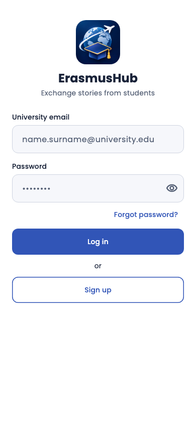

# Navigation and integration — through November 18 milestone

Source: the user-supplied `CS310_Group25_Step2.1.pdf`, especially the flow on
page 1 and login states on page 2. The task list says 15 routes, but the PDF has
16 distinct screens: page 14 contains both Profile and Edit profile. Both have
separate routes so the PDF flow is reachable. Dialogs do not get extra routes.

| Screen | Route | Current implementation |
| --- | --- | --- |
| Login | `/login` | Full login UI with inline validation and local logo |
| Forgot password | `/forgot-password` | Three wireframe states: enter email, link sent with 3-minute lock, resend available (UI only) |
| Sign up: account | `/sign-up` | Existing account form connected |
| Sign up: profile | `/sign-up/profile` | Existing profile form connected |
| Verify email | `/verify-email` | Waiting (3-minute resend lock) and not-verified states, Change email; optional `?email=` |
| Home | `/` | Scaffold |
| University detail | `/universities/:id` | Scaffold, retains Home tab |
| Post detail | `/posts/:id` | PostDetailScreen, comments and report dialog |
| New post | `/posts/new?universityId=...` | NewPostScreen, validated form and confirmation |
| Places | `/places` | City picker, category chips, compact PlaceCards with remove/undo, empty city state |
| Add place | `/places/new` | Name, city, category, rating, optional comment; inline errors and Place added dialog |
| Matches | `/matches` | Host university and department pickers, returned students with contact links, empty state |
| Profile | `/profile` | ProfileScreen with exchange cards and contacts |
| Edit profile | `/profile/edit` | EditProfileScreen, validation and exchange management |
| Add exchange | `/profile/exchanges/new` | AddExchangeScreen, add/edit with typed return value |
| Add university | `/add-university` | Scaffold reachable from Home and sign-up |

`AppRoutes` defines links; dynamic IDs are URL encoded. Named routes are also
available in `app_router.dart`. `/posts/new` is registered before the dynamic
post route. Unknown links show a recoverable Page not found screen.

## AppShell

The bottom bar has exactly the PDF's four destinations: Home, Places, Matches,
Profile. `StatefulShellRoute.indexedStack` preserves each tab's navigation stack.
Tapping the selected tab again returns it to its root. Main screens and university
detail keep the bottom bar; auth, forms and post detail use the root navigator.
Back from a pushed form restores its caller. Directly opened scaffolds provide a
fallback back destination. Feature teams replace the scaffold bodies without
changing this contract. Preview links use the sample IDs `tu-delft` and `post1`.

## Login and common widgets

The login follows the PDF hierarchy: bundled logo, app name, subtitle, university
email, password with visibility toggle, Forgot password, Log in, and Sign up.
The logo in `assets/images/erasmus_hub_logo.png` was extracted unchanged from the
PDF's embedded 256×256 image; it requires no network or additional package.
The existing Poppins theme and color tokens are retained.

Email validation permits only `.edu` / `.edu.tr`, including subdomains, while
rejecting malformed domains and lookalike suffixes. Password is required and has
an eight-character minimum, consistent with the account form. Errors are inline;
password values are never trimmed, persisted or logged. Keyboard Next/Done,
password visibility, scrolling and autofill are supported.

This is the Step 2.1 **UI prototype**, not Firebase authentication. As specified
in the PDF, valid Log in opens Home; no backend login, real session, password
reset, verification email or authorization boundary is claimed. Direct routes
remain available for feature development. Remaining scaffolds are explicitly listed in the table above. Post/profile edits are
in memory only; confirmations and reporting do not represent backend writes.

Shared widgets live under `lib/shared/widgets/`:

- `AppButton`: filled/outlined, disabled and loading states; loading blocks repeat taps.
- `AppTextField`: accessible external label, controller, inline validator, input action,
  autofill, suffix action and multiline support.
- `AppCard`: padded card with optional tappable Material surface.
- `StarRating`: read-only fractional stars or controlled accessible 1–5 input.
- `UserAvatar`: image with Unicode initials fallback, including failed image loads.

## Validation

`flutter analyze` and `flutter test` cover all 16 direct routes plus unknown-link
recovery, login errors/success/password visibility, connected sign-up navigation,
tab selection/restoration, form overlays, logout, common-widget behavior and a
320×568 login viewport with 1.6× text and keyboard inset.

Reference renders at 390×844, using the bundled fonts and logo:

| Default | Invalid university email |
| --- | --- |
|  |  |

These are Flutter widget renders, not physical-device screenshots.

## November 17 integration checks

The `feat/posts` branch was merged into the integration branch together with the
profile work already merged in main (PRs #6 and #7). The three routes now build
PostDetailScreen (path ID), NewPostScreen (university query parameter) and
AddExchangeScreen (optional existing experience). Post pages are keyed by ID so
changing URLs cannot retain a previous post. The static `/posts/new` route stays
before `/posts/:id`.

The merged profile model uses `major`, so post/exchange forms now consume that
field. Edit profile consumes AddExchangeResult, adds or replaces the matching
experience without duplication, and preserves Going/Returned. Direct Add exchange
and Edit profile URLs also save and return safely without requiring a prior stack.
All six post ratings are validated. Empty comments are rejected for keyboard
submission as well as the button.

The overflow matrix covers all 16 screens at 320×568, 360×640 and 430×932 with
1.3× text scaling. Additional tests cover keyboard insets, comments/reporting,
new-post publication, add/edit exchange, confirmation dialogs and direct-link
fallbacks. Android debug APK build is checked separately; iOS device verification
requires full Xcode and is not claimed on this machine.

Final verification on 2026-11-17 (Flutter 3.47.6 / Dart 3.13.5):

- `flutter analyze`: no issues.
- `flutter test`: 90 passed, including 48 route/viewport combinations.
- `flutter build apk --debug`: successful Android debug APK.
- iOS build/device testing not run: full Xcode is not installed.

Integration is delivered on `feat/efe-final-integration`; this does not claim that
this branch has already been merged into main. Previous infrastructure/navigation
and profile PRs #1–7 are already present in the main revision used here.
